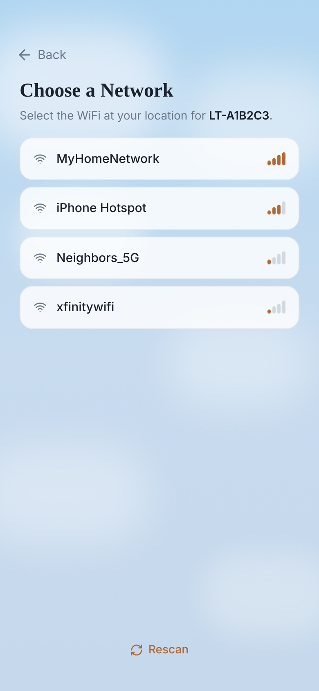
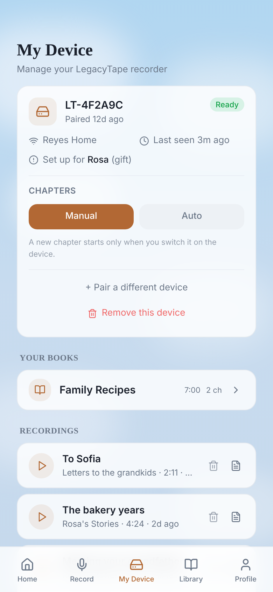
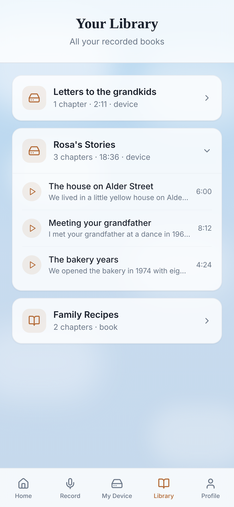
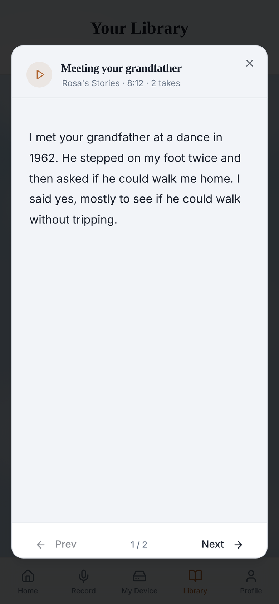
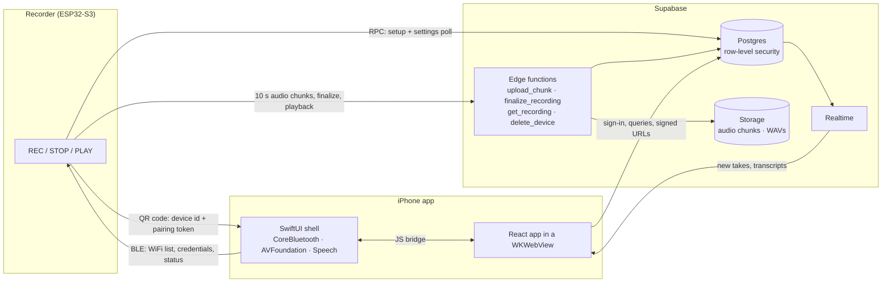

#  Legacy Tape app

Legacy Tape is a cassette-recorder-style device for recording life stories: someone presses REC
and talks, and their family ends up with the recordings and the transcripts, organized into books
and chapters. This repository is the companion iPhone app that sets the recorder up and turns what
it records into something people can listen to and read, plus the Supabase backend the recorder
uploads to. The device firmware is in [legacy-tape-firmware](https://github.com/Bchiate/legacy-tape-firmware).

The app is distributed to testers through TestFlight.

<p>
  
  
  
  
</p>

<sub>Pairing, My Device, the Library, and a chapter's transcript. The family in the screenshots is fictional.</sub>

## What it does

- **Pairs a recorder with a QR code and Bluetooth.** Scan the code on the device's screen, pick
  the WiFi network the device found, and the phone sends the credentials over Bluetooth LE. A
  short onboarding records who the recorder is for, their name and pronouns, and ten questions
  about their life.
- **Turns recordings into chapters.** The recorder streams audio to the cloud while the person is
  still talking. Each take appears in the app as soon as the recorder finishes uploading it, is
  transcribed on the phone with Apple's speech recognizer, and plays back to back with the other
  takes in its chapter.
- **Records on the phone too**, with guided interview questions read aloud and live transcription.
- **Shares with family.** Relatives enter an 8-character family code to read the books recorded in
  the app.
- **Manages the recorder:** when it starts a new chapter (on a button press or every few minutes),
  renaming and deleting takes, and removing the device, which deletes everything it recorded.

## How it fits together



The interface is a React app compiled into the iOS bundle and served to a `WKWebView` through a
custom `app://` URL scheme, so it loads instantly with no web server. The native side does what a
web view can't: it scans QR codes (AVFoundation), talks to the recorder over Bluetooth LE
(CoreBluetooth), runs speech recognition (Speech), and handles Google and Apple sign-in in the
system browser sheet. JavaScript calls Swift through `window.__pairingBridge` and
`window.__speechBridge`, and Swift answers by calling back into the page.

## Pairing

1. The recorder shows a QR code: `legacytape://pair?d=LT-A1B2C3&t=<32 hex characters>`, its
   hardware id and a pairing token it generated. The app reads it with its own scanner, or the
   system Camera app opens the app through the URL scheme.
2. The app connects over BLE and reads the networks the recorder can see, so the user picks one
   instead of typing an SSID.
3. With the password entered, the app saves the `devices` row for the signed-in account, writes
   `{token, ssid, pw, acct}` (plus an optional second network, for a recorder given as a gift) to
   the pairing characteristic, and follows the status characteristic until the recorder reports
   that it is on WiFi.
4. The onboarding answers are saved and `onboarding_complete` is set. The recorder, polling
   `device_status`, leaves its pairing screen.

| BLE characteristic | UUID | |
|---|---|---|
| Service | `1ec0de7a-7e2d-4f4f-9c1d-1ec0de7a0001` | |
| Pairing payload | `…0002` | write |
| Status | `…0003` | notify: `0x01` validating, `0x02` joining WiFi, `0x03` paired, `0xE1`–`0xE4` errors (token mismatch, bad payload, WiFi failed, internal) |
| WiFi networks | `…0004` | read / notify: JSON list of `{ssid, rssi}` |

## Recording

1. While recording, the device uploads 10-second chunks of 16 kHz mono 16-bit PCM to
   `upload_chunk` (`recording_chunks/<device>/<session>/<n>.pcm`). Uploads are idempotent, so the
   device can retry any chunk.
2. On STOP, `finalize_recording` checks that every chunk arrived (when the firmware says how many it
   made), joins them behind a WAV header, stores the take at `recordings/<account>/<session>.wav`,
   inserts the row and deletes the chunks. Retrying a finalize returns the same recording.
3. The new row reaches the app over Realtime. The app downloads the WAV through a signed URL,
   transcribes it on the phone one take at a time, and writes the transcript back to the row.
4. A chapter is every take with the same book id and chapter number. `get_recording` returns a
   chapter's takes in order with signed URLs, and the device plays them back to back as one
   timeline.

## Security model

- **Owner-only tables.** Every table has row-level security scoped to the signed-in user, and
  column grants limit what can change: an owner can write a transcript back to a take but cannot
  change where its audio lives or who owns it. Anonymous callers have no table access at all.
- **Devices never hold a user session.** A recorder identifies itself with its hardware id and
  pairing token. The edge functions compare the token in constant time, then act only for the
  account that owns the device, never an account named in the request.
- **Family sharing through one narrow function.** `family_story(code)` returns a storyteller's
  first name and books for a matching family code (40 random bits) and nothing else: no account
  ids, no email addresses.
- **Removing a device needs the owner's session**, checked with Supabase Auth inside the function.
- The policies are tested against real Postgres, querying as the `anon` and `authenticated` roles.

## Repository layout

```
ios/                  SwiftUI shell: WKWebView host, BLE pairing, QR scanner, speech bridge
web/                  React 18 + TypeScript (Vite, Tailwind, shadcn/ui, TanStack Query)
supabase/
  migrations/         schema, row-level security and column grants, RPCs
  functions/          Deno edge functions; handlers depend on a small Store interface
  tests/              database tests on PGlite (Postgres compiled to WebAssembly)
```

## Running it

**Backend.** Create a Supabase project, then from the repository root:

```sh
supabase link --project-ref <your-project-ref>
supabase db push
supabase functions deploy upload_chunk finalize_recording get_recording delete_device --no-verify-jwt
```

**Web app** (also runs in a desktop browser, where pairing is simulated):

```sh
cd web
cp .env.example .env.local    # your project URL and publishable key
npm install
npm run dev
```

**iOS app.** Build the web bundle into the app, then open the project in Xcode 26.4 or later,
choose your team, and run it on an iPhone (Bluetooth and the camera need a real device):

```sh
cd web && npm run build:ios
open ../ios/MyLegacyTape.xcodeproj
```

**Recorder.** Flash [legacy-tape-firmware](https://github.com/Bchiate/legacy-tape-firmware) with the
same project URL and publishable key.

## Tests

```sh
deno task test            # 53 backend tests: edge function handlers and the database
cd web && npm test        # grouping takes into chapters and books, onboarding questions
```

The iOS target has Swift Testing tests for the QR code parser (⌘U in Xcode). CI runs the backend
and web checks on every push.

## Credits

UI components from [shadcn/ui](https://ui.shadcn.com). The interview questions' voice prompts were
generated with ElevenLabs.
